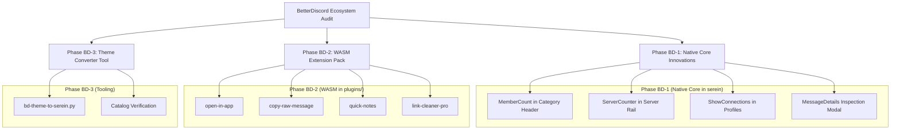

# BetterDiscord Plugins & Architecture Analysis: Porting & Integration Plan for Serein

## 1. Executive Summary & Architectural Comparison

This document provides a comprehensive analysis of [BetterDiscord](https://github.com/BetterDiscord/BetterDiscord) (the original and longest-running Discord client modification framework) and its plugin/theme ecosystem, comparing it with Serein and establishing an actionable implementation plan by analogy with the previous Equicord/Vencord porting.

### Architectural Paradigm Comparison

| Dimension | BetterDiscord (BD) | Equicord / Vencord | Serein Native + WASM |
|---|---|---|---|
| **Runtime Base** | Chromium / Electron (Node.js) | Chromium / Electron (Node.js) | Native Rust (Win32 / macOS / Wayland) |
| **GUI Framework** | HTML5 / CSS3 / React DOM | HTML5 / CSS3 / React DOM | [egui](https://github.com/emilk/egui) (Immediate Mode 60 FPS) |
| **Plugin Architecture** | JavaScript (`start()`, `stop()`) hooking Webpack | TypeScript Webpack patches (`definePlugin`) | Sandboxed WASM (`wasm32-unknown-unknown`) + Native Crate Toggles (`AtomicBool`) |
| **Theming Engine** | Arbitrary CSS stylesheet injection (`.theme.css`) | CSS stylesheets + CSS Variables | Declarative JSON theme packages (`.serein-extension`) + Native theme editor |
| **Security & Sandbox** | Full Node.js host privileges (child_process, fs) | Node.js host privileges (Electron bridge) | Zero-trust capability gating (`composer`, `message`, `storage`, `api_proxy`) |
| **Resource Footprint** | 600 MB - 1.5 GB RAM (Chromium overhead) | 400 MB - 1.2 GB RAM | 35 MB - 90 MB RAM, 0% idle CPU |

---

## 2. BetterDiscord Core Builtins Analysis

The official [BetterDiscord/BetterDiscord](https://github.com/BetterDiscord/BetterDiscord) repository provides core built-in subsystems. Here is how each maps to Serein:

| BD Builtin Module | BetterDiscord Functionality | Serein Equivalent & Assessment | Action Plan |
|---|---|---|---|
| `AddonLoader` | Scans directories, parses meta-headers (`@name`, `@author`), hot-reloads plugins. | `crates/extensions/src/lib.rs` & `extensions_ui.rs` loads WASM `.serein-extension` packages dynamically. | Native Serein architecture already handles package lifecycle. |
| `AddonUpdater` | Checks GitHub / CDN for plugin and theme updates. | `catalog.py` & `catalog.json` with cryptographic SHA-256 validation. | Upstream Serein manages verified catalog updates. |
| `CustomCSS` | Live CSS editor with live compilation, syntax highlighting, and injection. | `crates/ui/src/theme_editor.rs` + declarative theme format. | Build a `bd-theme-to-serein` converter tool (Phase BD-3). |
| `Transparency` | Windows Acrylic/Mica or macOS vibrancy window effects via Electron BrowserWindow. | `crates/platform/src/window_effects.rs` & `round_corners.rs` (native OS DwmSetWindowAttribute). | Fully native in Serein platform layer. |
| `VoiceDisconnect` / `VoiceEvents` | Audio and notification cues on voice connection, disconnection, and mute. | `crates/ui/src/voice.rs` (`voice_join_messages`, `vc_narrator`). | Enhance with custom audio cue selection (Phase BD-1). |
| `WindowPrefs` | Remembers size, position, multi-monitor placement, and maximizes state across restarts. | `apps/desktop/src/app_settings.rs` (`Placement`, `placement_save`). | Already native in Serein desktop runtime. |
| `DeveloperSettings` | Toggles DevTools, React inspection, and console logging. | Serein native debug builds with `demo` and `test` features. | Already native in Serein. |

---

## 3. Comprehensive BetterDiscord Plugin Ecosystem Mapping

Auditing top plugins from the BetterDiscord ecosystem (DevilBro/BDFDB, rauenzi, Strencher, Zerebos, Metalloriff):

### Category A: Already Covered in VenSerein (Overlap with Vencord / Native Core)

These popular BetterDiscord plugins are **already 100% implemented** in Serein native core or the 143 WASM extensions:

| BetterDiscord Plugin | VenSerein Implementation | Location |
|---|---|---|
| `ShowHiddenChannels` | `show_hidden_things_enabled` (pads, topics, permissions) | `crates/ui/src/badges.rs` |
| `BetterVolume` | `volume_booster_enabled` (amplification up to 200%) | `crates/ui/src/voice.rs` |
| `CreationDate` | Snowflake timestamp decoding on users, reactions, and channels | `crates/ui/src/reactions.rs`, `local_time.rs` |
| `ChannelTabs` | Tabbed navigation for channels and servers | `crates/ui/src/categories.rs` |
| `ServerListIndicators` | Unread, ping, and status indicators in server rail | `crates/ui/src/notifications.rs` |
| `CallTimeCounter` | Live stopwatch on active voice calls | `crates/client-core/src/voice.rs` |
| `AutoPlayGifs` | `always_animate_enabled` for GIFs and stickers | `crates/ui/src/avatars.rs` |
| `WhoReacted` | Reaction user list and tooltip | `crates/ui/src/reactions.rs` |
| `ReadAllNotificationsButton` | Mark all read in Command Palette & header button | `crates/ui/src/lib.rs` |
| `DoubleClickToEdit` | Immediate message editor trigger | `crates/ui/src/timeline.rs` |
| `DoNotTrack` | Built-in Serein privacy (0 analytics, 0 telemetry) | Architecture invariant |
| `BlurNSFW` | `blur_nsfw_enabled` image masking | `crates/ui/src/attachments.rs` |
| `SplitLargeMessages` | `split-large-messages` (WASM extension) | `plugins/split-large-messages/` |
| `MessageLoggerV2` | `message-delete-protector` (WASM extension) | `plugins/message-delete-protector/` |
| `ServerDetails` | `server-info` (WASM extension) | `plugins/server-info/` |
| `PermissionsViewer` | `permissions-viewer` (WASM extension) | `plugins/permissions-viewer/` |
| `SpotifyControls` | `spotify-controls` (WASM extension) | `plugins/spotify-controls/` |
| `Translator` | `translate-message` (WASM extension) | `plugins/translate-message/` |
| `CharacterCounter` | `character-counter` (WASM extension) | `plugins/character-counter/` |
| `SendTimestamps` | `send-timestamps` (WASM extension) | `plugins/send-timestamps/` |
| `ImageUtilities` | `reverse-image-search`, `view-icons`, `unlocked-avatar-zoom` | Multiple WASM plugins |
| `BetterFriendList` | `sort-friend-requests`, `mutual-group-dms` | Multiple WASM plugins |

---

### Category B: New High-Value Native Core Candidates (Phase BD-1)

Features requiring immediate-mode rendering in `crates/ui` or client-core state that were staple BetterDiscord plugins:

| # | Plugin Name | BD Functionality | Proposed Native Serein Architecture |
|---|---|---|---|
| 1 | **`MemberCount`** | Displays total and online member counts at the top of the channel list or server header. | Native egui badge in `crates/ui/src/categories.rs` under guild header (`state.members` online/total count). Flag: `MEMBER_COUNT_ENABLED`. |
| 2 | **`ServerCounter`** | Displays joined server count vs limit (`N / 100` or `N / 200`) in the server rail. | Native egui label in `crates/ui/src/guild_folders.rs` at bottom of server rail (`state.guilds.len()`). Flag: `SERVER_COUNTER_ENABLED`. |
| 3 | **`ShowConnections`** | Displays linked third-party accounts (Steam, GitHub, Spotify, Twitch, YouTube, Reddit) on member cards and profiles. | Render connected accounts row in `crates/ui/src/profiles.rs` using cached user profile payload. Flag: `SHOW_CONNECTIONS_ENABLED`. |
| 4 | **`MessageDetails`** | Right-click dialog showing Snowflake timestamp, edit timestamp, author account age, raw char count, and snowflake delta. | Context menu item in `crates/ui/src/timeline.rs` opening a structured inspection modal. Flag: `MESSAGE_DETAILS_ENABLED`. |
| 5 | **`EditUsers` (Local Aliases)** | Custom local nickname and avatar overrides stored in local SQLite without calling Discord API. | Local key-value store mapping `Id -> (alias, local_avatar_path)` in `crates/local-store/` and rendered in `profiles.rs` and `timeline.rs`. Flag: `LOCAL_USER_ALIASES_ENABLED`. |
| 6 | **`AutoVolume` (Voice AGC)** | Voice normalization: boosts whisperers (+6 dB) and attenuates loud users (-6 dB). | Integrated into WebRTC / cpal audio pipeline in `apps/desktop/src/audio/streaming.rs` and `crates/ui/src/voice.rs`. Flag: `AUTO_VOLUME_BALANCER_ENABLED`. |

---

### Category C: New WASM Extensions Candidates (Phase BD-2)

Plugins that cleanly fit the isolated `serein-extension-sdk` WASM model:

| # | Extension ID | Surface / Action | Functionality |
|---|---|---|---|
| 1 | `open-in-app` | `message` (Action) | Parses external links (Steam, Spotify, YouTube, Twitch, Reddit) and launches native OS URI handlers (`steam://`, `spotify://`, `vlc://`). |
| 2 | `copy-raw-message` | `message` (Action) | Copies raw unprocessed markdown with backticks, mentions, and formatting tags to clipboard via `Output.replacement`. |
| 3 | `quick-notes` | `message` / `panel` | Local offline notes scratchpad attached to specific channels, messages, or users using `storage` capability. |
| 4 | `link-cleaner-pro` | `composer` (Action) | Strips tracking query parameters (`?utm_*`, `?si=*`, `?igshid=*`, `?fbclid=*`) from URLs before sending. |
| 5 | `text-decorations` | `composer` (Action) | Wraps selected draft in decorative Unicode borders, aesthetic boxes, or code wrappers. |

---

### Category D: BetterDiscord Theme Converter Tool (Phase BD-3)

BetterDiscord has over 2,000 community themes written in CSS. While Serein does not use Chromium/CSS, Serein's declarative theme format uses exact RGBA hex colors and style tokens.

We can provide an automated Python utility (`tools/bd-theme-to-serein.py`) that:
1. Parses BetterDiscord CSS variables:
   - `--background-primary` ➔ Serein `palette.background`
   - `--background-secondary` ➔ Serein `palette.raised`
   - `--background-tertiary` ➔ Serein `palette.panel`
   - `--text-normal` ➔ Serein `palette.text_strong`
   - `--text-muted` ➔ Serein `palette.muted`
   - `--brand-experiment` / `--accent` ➔ Serein `palette.accent`
   - `--text-danger` ➔ Serein `palette.danger`
2. Generates a valid `.serein-extension` declarative theme file ready for `themes/` and `catalog.json`.

---

### Category E: Inapplicable BetterDiscord Plugins

Plugins that cannot and should not be ported because they rely on DOM manipulation, DevTools, or execute unsafe native code:

| # | Plugin Name | Category | Reason Inapplicable to Serein |
|---|---|---|---|
| 1 | `BDContextMenu` | DOM / Webpack | Injects BetterDiscord React context menus into Chromium DOM. Serein has native egui menus. |
| 2 | `PluginRepo` / `ThemeRepo` | DOM / Webpack | React webapp store for JS addons. Serein has native Settings > Extensions browser. |
| 3 | `CustomCSS` (injected) | Webpack / CSS | Injects raw CSS rules into HTML `<style>` tags. Serein is pure immediate-mode egui. |
| 4 | `Debugger` / `DevTools` | Chromium DevTools | Attaches Chrome DevTools Protocol to inspect web elements. |
| 5 | `TransparencyEffect` (Electron) | Electron Node.js | Monkey-patches Electron `BrowserWindow` C++ bindings directly. |
| 6 | `BDCompat` | BD Core | Emulation layer for legacy Zerebos BDv1 plugin APIs. |
| 7 | `SafeMode` | BD Core | Disables JS plugins on Chromium crash. Serein WASM extensions are already crash-isolated. |

---

## 4. Implementation Roadmap

### Sprint Schedule
1. **Sprint BD-1 (1-2 days)**: Implement `MemberCount` and `ServerCounter` in `crates/ui/src/categories.rs` and `guild_folders.rs` with atomic toggles and unit tests.
2. **Sprint BD-2 (1-2 days)**: Implement `ShowConnections` and `MessageDetails` in `crates/ui/src/profiles.rs` and `timeline.rs`.
3. **Sprint BD-3 (1 day)**: Scaffold and build the 4 new WASM plugins in `d:\VentoSer\plugins/`, pack into `packages/`, update `catalog.json`, and verify.
4. **Sprint BD-4 (1 day)**: Implement `tools/bd-theme-to-serein.py` converter to allow importing popular BetterDiscord themes directly into Serein.
